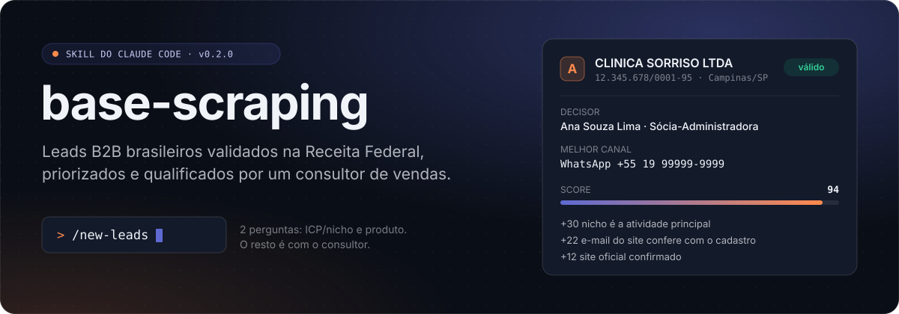
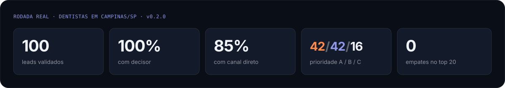
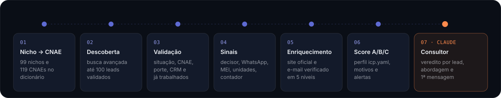

<p align="center">
  
</p>

<p align="center">
  <a href="https://github.com/b3rt0-tech/base-scraping/releases/tag/v0.2.0"></a>
  
  
  
  
  
</p>

<p align="center">
  <a href="#começar">Começar</a> ·
  <a href="#new-leads">/new-leads</a> ·
  <a href="#cli">CLI</a> ·
  <a href="#perfil-do-cliente-ideal">Perfil ICP</a> ·
  <a href="#planilha-para-o-crm">Planilha</a> ·
  <a href="#aprender-com-resultados">Resultados</a> ·
  <a href="#lgpd-e-compliance">LGPD</a>
</p>

---

Você diz **quem é o seu cliente** e **o que você vende**. O base-scraping devolve até 100 empresas reais, ativas na Receita Federal, já prontas para o vendedor trabalhar:

- **Quem decide**: o sócio-administrador, tirado do quadro societário.
- **Por onde falar**: o melhor canal direto (WhatsApp provável, e-mail confirmado no site, telefone). O contato do escritório de contabilidade nunca conta como canal.
- **Por que está na lista**: prioridade **A/B/C**, score com motivos que somam os pontos e alertas que já dizem o que fazer.
- **O que dizer**: o Claude, como consultor de vendas, dá o veredito de cada lead e escreve a **1ª mensagem** de cada lead A.

Sem dado inventado: todo campo traz de onde veio e quando (`proveniencia`).

<p align="center">
  
</p>

## Como funciona

<p align="center">
  
</p>

O **[BaseCNPJ](https://basecnpj.app) é a espinha dorsal**: ele define quem é lead e valida quem continua no funil. O scraping só completa o que o cadastro não tem (site, e-mail comercial vivo, redes sociais). Se o scraping falhar, o lead continua na lista, só com menos campos.

| Etapa | O que faz | Fonte |
|---|---|---|
| **Nicho → CNAE** | Traduz o pedido em filtros: nicho → CNAE (99 nichos, 119 CNAEs em [`references/cnae.md`](references/cnae.md)), cidade, porte, bairro por CEP | dicionário |
| **Descoberta** | Pagina a busca avançada e valida em rodadas até **100 leads validados** (teto de segurança de 500 descobertos). Uma vaga por empresa, mesmo com várias filiais | `route=avancada` |
| **Validação** | Situação cadastral, CNAE, porte; tira quem já está no CRM (`--excluir`) e quem já foi trabalhado | `route=cnpj` |
| **Sinais** | Decisor, WhatsApp provável (celular no formato antigo vira `+55DDD9…`), MEI, unidades, anos de mercado e contato de contador | `route=cnpj` |
| **Enriquecimento** | Confirma o site oficial (pelo e-mail cadastral ou pela busca web), extrai contatos e verifica e-mail em 5 níveis | scraping |
| **Score A/B/C** | Pontua de 0 a 100 com o perfil `icp.yaml`; cada ponto tem um motivo | — |
| **Consultor** | O Claude analisa ICP e produto, dá o veredito de cada lead e escreve a 1ª mensagem | `--qualificacoes` |

Os scripts nunca chamam um LLM: são determinísticos e testados. Quem interpreta e julga é o Claude, seguindo [`references/consultoria.md`](references/consultoria.md).

## Começar

Pré-requisitos: [`uv`](https://docs.astral.sh/uv/getting-started/installation/) e uma conta no [BaseCNPJ](https://basecnpj.app) no plano **Business** (a busca avançada exige esse plano).

```bash
git clone https://github.com/b3rt0-tech/base-scraping.git
cd base-scraping
uv sync

cp .env.example .env          # preencha BASECNPJ_TOKEN=<seu token>
```

O token é gerado no painel do BaseCNPJ, em **API Keys**. O `.env` é lido da raiz da skill, então o comando funciona de qualquer pasta, e nunca entra no repositório. Sem token, o CLI responde `erro: token_ausente`; token recusado é `erro: token_invalido`.

### Instalar como skill do Claude Code

Ligue a pasta e o comando `/new-leads` ao Claude Code com links simbólicos (um `git pull` atualiza os dois):

```bash
mkdir -p ~/.claude/skills ~/.claude/commands
ln -s "$(pwd)" ~/.claude/skills/base-scraping
ln -s "$(pwd)/commands/new-leads.md" ~/.claude/commands/new-leads.md
```

Prefere copiar? `cp -r . ~/.claude/skills/base-scraping` (ou `.claude/skills/base-scraping` para valer só num projeto) e rode `uv sync` lá dentro. Depois, abra uma **sessão nova** do Claude Code: skills são carregadas no início da sessão.

## /new-leads

Digite `/new-leads`. O Claude faz só duas perguntas, nesta ordem:

```text
1-) Qual o ICP/Nicho?     → clínicas odontológicas em Campinas
2-) Qual o produto?       → software de agenda e prontuário, R$ 300/mês
```

A partir daí, ele age como **consultor de vendas** e segue sozinho até a entrega:

1. **Analisa** o ICP (nicho → CNAEs, cidade, porte) e o produto (quem decide, dor, ticket, contra-indicações).
2. **Monta o perfil** `icp.yaml` e, se houver resultados registrados, ajusta o perfil pelo que converteu.
3. **Minera** os 100 leads e procura o site dos que vieram sem canal.
4. **Qualifica** cada lead (`valido`, `talvez`, `descartar`) com motivo e abordagem, e escreve a **1ª mensagem** dos leads A.
5. **Entrega** o resumo do lote, a tabela priorizada e a planilha `.xlsx`.

Ele só volta a perguntar se faltar a cidade/UF, se o nicho for ambíguo ou se o token não estiver configurado. Fora do `/new-leads`, pedidos em linguagem natural também ativam a skill: *"me traz dentistas ativos em Campinas, porte ME"*.

## CLI

Todos os comandos devolvem **JSON** no stdout. O progresso vai para o stderr.

```bash
# descoberta + validação cadastral, sem scraping
uv run python -m scripts.pipeline_cli descobrir "dentista" --uf SP --municipio Campinas --porte ME

# pipeline completo: sinais, enriquecimento, score A/B/C
uv run python -m scripts.pipeline_cli prospectar "dentista" --uf SP --municipio Campinas --perfil icp.yaml

# valida uma lista própria (CNPJs ou nomes), sem descoberta
uv run python -m scripts.pipeline_cli validar-lista --arquivo lista.json

# próximos 100 da mesma consulta, sem repetir
uv run python -m scripts.pipeline_cli prospectar "dentista" --uf SP --municipio Campinas --continuar
```

`lista.json` é uma lista de `{"cnpj": "..."}` ou `{"nome": "...", "uf": "SP", "municipio": "Campinas"}`, com até 100 itens. Nomes ambíguos vão para `nao_resolvidos`: o pipeline nunca chuta.

<details>
<summary><b>Todas as flags</b></summary>

| Flag | Efeito |
|---|---|
| `--uf` / `--municipio` | UF e município do cadastro |
| `--porte` | `ME`, `EPP` ou `demais` |
| `--cep` | prefixo de CEP: filtra por **bairro/região** (ex. `--cep 0507` cobre a região da Lapa, em São Paulo) |
| `--matriz` | só estabelecimentos matriz |
| `--situacao` | situação cadastral desejada (padrão: `ativa`) |
| `--continuar` | entrega os **próximos 100 validados** da mesma consulta. Sem a flag, a mesma consulta devolve sempre o lote 1. A saída informa `lote` |
| `--perfil` | `icp.yaml` com o perfil do cliente ideal. Padrão: `icp.yaml` na raiz da skill, se existir |
| `--excluir` | arquivo do CRM (`.csv`, `.txt` ou `.json`, sem preparo) com CNPJs e/ou e-mails/domínios. CNPJ exclui a empresa inteira (todas as filiais); domínio exclui quem tem o mesmo domínio no e-mail cadastral (Gmail/Hotmail são ignorados). A descoberta repõe as vagas. A saída informa `excluidos` |
| `--sites-json` | `{"<cnpj>": "<url candidata>"}` para enriquecer pelo site. Tem prioridade sobre o site automático pelo e-mail cadastral |
| `--qualificacoes` | `{"<cnpj>": {"veredito": "valido\|talvez\|descartar", "motivo", "abordagem"?, "mensagem"?}}`: o veredito do consultor. Entra em `qualificacao`, na ordenação e na planilha |
| `--formato` / `--saida` / `--separador` | `csv` ou `xlsx` grava a planilha e o stdout traz só o resumo. CSV em UTF-8 com BOM, separador `,` (CRM) ou `;` (Excel em português) |
| `--arquivo` | (só em `validar-lista`) a lista de CNPJs/nomes |
| `--db-path` | onde fica o checkpoint SQLite (padrão: `.cache/pipeline.sqlite3`) |
| `--verbose` / `--quiet` | mais ou menos detalhe no stderr |

</details>

Rodar o mesmo comando de novo é seguro e rápido: o checkpoint SQLite e o cache evitam refazer chamadas.

## Perfil do cliente ideal

O nicho diz **quem buscar**; o perfil diz **quem vale mais para o seu produto**. Copie [`icp.example.yaml`](icp.example.yaml) para `icp.yaml` (ou passe `--perfil arquivo.yaml`) e ajuste:

- **`pesos`**: as dimensões do score, que somam 100, incluindo `fit` (encaixe com o perfil).
- **Critérios de fit**: `capital_social`, `anos_de_mercado` e `unidades` em faixas `minimo`/`ideal`; `portes_preferidos`, `municipios_prioritarios`, `cnaes_prioritarios`, `tecnologias` do site e `whatsapp`.
- **`excluir`**: critérios eliminatórios (`mei`, `empresa_nova`). A descoberta repõe as vagas.
- **`prioridade`**: os cortes de score para A e B.

A prioridade é **A** com score acima do corte, canal direto e decisor; **C** sem canal direto ou com score baixo; **B** no resto. Em dentistas de Campinas, o top 20 passou de 1 score distinto (todos empatados em 64) para 20 distintos com o perfil de exemplo.

## Planilha para o CRM

```bash
uv run python -m scripts.pipeline_cli prospectar dentista --uf SP --municipio Campinas --formato xlsx
```

Uma linha por lead, na ordem de trabalho (veredito, depois prioridade, depois score). As colunas são sempre as mesmas, então o mapeamento no CRM é feito uma vez só:

| Coluna da planilha | HubSpot (Empresa / Contato) | Pipedrive (Organização / Pessoa) |
|---|---|---|
| Empresa | Company name | Organization name |
| CNPJ | propriedade customizada `cnpj` | campo customizado `CNPJ` |
| Cidade / UF | City / State/Region | Address |
| Decisor | Contact: First + Last name | Person name |
| Cargo do decisor | Contact: Job title | Person: campo `Cargo` |
| WhatsApp | Contact: Mobile phone number | Person: Phone (celular) |
| E-mail | Contact: Email | Person: Email |
| Telefone | Company: Phone number | Organization: campo `Telefone` |
| Site | Company domain name | Organization: campo `Site` |
| Prioridade, Score, Veredito | propriedades customizadas (ou Lead status) | Label / campos customizados |
| Motivos, Alertas, Abordagem, 1ª mensagem | Note | Note |

No HubSpot, importe como **Empresas e Contatos** num arquivo só; no Pipedrive, como **Organizações e Pessoas**. Contato de contador não vai para as colunas E-mail e Telefone.

## Aprender com resultados

```bash
# o que aconteceu com os leads trabalhados (CSV/JSON com cnpj, status, motivo)
uv run python -m scripts.pipeline_cli registrar-resultado --arquivo resultados.csv

# funil por prioridade, CNAE, porte, cidade e sinal (MEI, WhatsApp, multiunidade, contador)
uv run python -m scripts.pipeline_cli relatorio-resultados
```

Status: `contatado`, `respondeu`, `reuniao`, `ganho`, `perdido` e `nao_e_fit` (variações como "Reunião marcada" e "sem interesse" também valem). CNPJ com resultado **não volta** como lead novo (`ja_trabalhados` na saída). No `/new-leads`, o consultor lê o relatório e ajusta o perfil antes de minerar. O banco guarda só o CNPJ e atributos da empresa, sem dado pessoal.

## Exemplo de saída

Dados fictícios, no formato real de `prospectar` (trecho):

```json
{
  "icp": { "nicho": "dentista", "entrada_dicionario": "dentista", "cnaes": ["8630504"], "perfil": "icp.yaml" },
  "total": 100, "lote": 1, "validados": 100, "esgotou_busca": false, "excluidos": 3, "ja_trabalhados": 12,
  "resumo": {
    "total": 100, "por_prioridade": { "A": 42, "B": 42, "C": 16 },
    "com_decisor": 100, "com_canal_direto": 85, "com_whatsapp": 54, "com_contato_de_contador": 21,
    "por_veredito": { "valido": 61, "talvez": 27, "descartar": 12 }
  },
  "leads": [
    {
      "cnpj": "12345678000195",
      "razao_social": "CLINICA SORRISO LTDA",
      "endereco": { "municipio": "CAMPINAS", "uf": "SP" },
      "decisores": [{ "nome": "ANA SOUZA LIMA", "qualificacao": "Sócio-Administrador", "origem": "quadro_societario" }],
      "site": "https://sorriso.com.br/",
      "score": 94.0,
      "prioridade": "A",
      "motivos": [
        "o nicho é a atividade principal (CNAE principal) (+30)",
        "e-mail do site confere com o cadastral (+22)",
        "site oficial confirmado (CNPJ/nome/telefone na página) (+12)"
      ],
      "canal_direto": true,
      "melhor_canal": { "tipo": "whatsapp", "valor": "+5519999999999" },
      "qualificacao": {
        "veredito": "valido",
        "motivo": "clínica estabelecida, decisora identificada e WhatsApp direto",
        "abordagem": "WhatsApp para a Ana, citando a agenda online",
        "mensagem": "Oi, Ana! Vi que a Sorriso atende em Campinas desde 2015..."
      },
      "flags": ["whatsapp_provavel"],
      "proveniencia": { "razao_social": { "fonte": "basecnpj", "rota_ou_url": "route=cnpj", "timestamp": 1700000000.0 } }
    }
  ],
  "descartados": [{ "cnpj": "11111111000111", "motivo": "situacao_cadastral=04 (esperado 02)" }]
}
```

O contrato é tipado (Pydantic, em [`scripts/pipeline/schemas.py`](scripts/pipeline/schemas.py)) e validado antes de ser impresso. O JSON Schema fica em [`schemas/lead.schema.json`](schemas/lead.schema.json) e a documentação de cada campo em [`schemas/lead.md`](schemas/lead.md).

## Limites de design

| Limite | Detalhe |
|---|---|
| Teto de leads | **100 validados por lote**; `--continuar` traz os próximos. Se a busca acabar antes, a saída avisa (`esgotou_busca`) |
| Resolução por nome | Só no `validar-lista`, com desempate por UF (a API não devolve município na busca por nome) |
| Rede societária | O cliente já expõe `routes.rede()`, mas o pipeline ainda não usa |
| Sites com JavaScript | Marcados como `requer_navegador` e pulados (sem Playwright) |
| Envio de mensagens | O consultor só redige; quem envia é o vendedor |
| LinkedIn | Fora de escopo: viola os Termos de Uso e é o maior risco de LGPD |

## Estrutura do projeto

```text
base-scraping/
├── SKILL.md                 instruções da skill (o Claude como consultor de vendas)
├── commands/new-leads.md    o comando /new-leads
├── icp.example.yaml         perfil do cliente ideal de exemplo
├── references/
│   ├── cnae.md              dicionário nicho → CNAE (99 nichos)
│   ├── consultoria.md       método do consultor: ICP, produto, veredito, 1ª mensagem
│   ├── basecnpj.md          rotas, filtros, erros e limites da API
│   ├── enriquecimento.md    receita do scraping (site, contato, e-mail)
│   └── compliance.md        LGPD, robots.txt, rate limiting
├── schemas/                 contrato de saída (JSON Schema + documentação)
├── scripts/
│   ├── basecnpj/            cliente da API (cache, retry, mapa de erros)
│   ├── pipeline/            descoberta, validação, sinais, perfil, score, explicação, planilha, resultados
│   ├── scraping/            site oficial, contatos, verificação de e-mail
│   └── pipeline_cli.py      CLI principal
└── tests/                   432 testes offline + 6 de integração
```

## Desenvolvimento

```bash
uv sync --all-groups
uv run ruff check . && uv run mypy scripts/ && uv run pytest     # sem rede e sem token
uv run pytest -m integration                                      # contra a API real (exige token)
```

O CI roda `ruff`, `mypy` e `pytest` a cada push e PR.

## LGPD e compliance

Dado de empresa é público; nome e e-mail de pessoa física são dados pessoais, tratados com finalidade clara (contato B2B) e com a origem registrada por campo. O decisor sai só com nome e qualificação, sem CPF. No scraping, o pipeline faz uma requisição por vez a cada domínio, respeita `robots.txt` e `Crawl-delay`, lê no máximo 5 páginas por domínio e guarda cache de 7 dias para não visitar o mesmo site duas vezes. Detalhes em [`references/compliance.md`](references/compliance.md).

## Licença

MIT. Ver [`LICENSE`](LICENSE).

<sub>Feito sobre os dados do <a href="https://basecnpj.app">BaseCNPJ</a>. Projeto independente, sem vínculo oficial com o BaseCNPJ.</sub>
